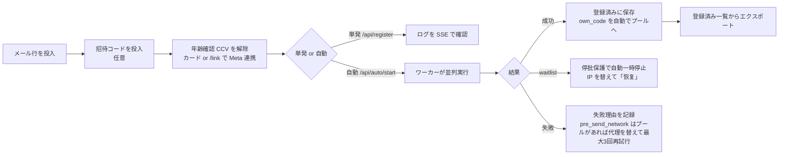

# muse-JP-Reg（日本語版 README）

`muse.ai` の**完全 HTTP（ブラウザ不要）大量自動登録**ツールです。Chrome の TLS/HTTP2 指紋を `curl_cffi` で偽装し、招待コードを自己増殖（1 枚 → 最大 30 回）させながらアカウントを量産します。管理は FastAPI + Vue 3 の Web コンソールから行います。

- 出典: `duwqijlk/muse-protocol` をベースにした WebUI 化
- 対象: **日本 (JP)**。非開放地域の IP で登録すると、オンボーディング完了後に `waitlist`（地区制限）へ落ちます
- 元の中国語 README は [README.md](README.md)、詳細な日本語解説は [docs/ja/](docs/ja/README.md)

## まず「何が必要か」

**住宅プロキシは必須ではありません。** 必須は次の 3 つです。

| 区分 | 項目 |
| --- | --- |
| 必須 | Python 3.10 以上 |
| 必須 | メール受信手段（`outlook` / `cf_temp` / `icloud_relay` のいずれか 1 つ） |
| 必須（どちらか） | 年齢確認 CCV の解除手段 = **カード**（日本発行の**クレジット**カード 1 枚、**デビット不可**）または **Meta 連携**（Facebook / Instagram 1 つ・**カード不要**） |
| 任意 | 住宅プロキシ（無ければ直結。`waitlist` 率が高くなったら追加） |
| 任意 | 招待コード（無ければ登録のみ。`redeem_mode=none`） |
| 不要 | Node.js、ブラウザ、Selenium / Playwright、商用メール API |

> [!IMPORTANT]
> カード経路（既定の `ccv_mode=card_then_link` が最初に試します）は Meta Pay 側で実在照会されます（`paymentContainerMode:"LIVE"`、1.00 USD の与信）。汎用テスト PAN（`4242…` / `4111…`）は通らず、**デビットカードも `code=1383254` で拒否**されます。
> **カードが無い / デビットしか無い場合は、WebUI「設定」→ `CCV: 解除方式` を `link` にして `http://127.0.0.1:8766/link` で Facebook / Instagram を承認してください（カード不要）。**
> CCV が未解除のアカウントは `/api/hatch/*` がすべて 403 になり、自分の招待コードが 1 枚も出ません（＝裂変が止まります）。

理由と根拠、プロキシ無しでの推奨設定は [docs/ja/requirements.md](docs/ja/requirements.md) にまとめています。

## セットアップ

1. Python 3.10+ を実体としてインストールします（Windows の Microsoft Store エイリアスだけでは動きません）。
   - Windows: `winget install --id Python.Python.3.12 --exact --scope user`
   - インストール後は**ターミナルを開き直してください**（PATH が古いままだと `python` が Store のエイリアスに解決され、終了コード 9009 になります）。
2. 依存をインストールします。
   - `python -m pip install -r requirements.txt`
   - スモークテストを実行する場合は追加で `pip install httpx`（`test_webui_smoke.py` が要求。`requirements.txt` にも追記済みなので、最新リビジョンなら不要）。
   - 最後に出る `… is not on PATH` の警告群は `Scripts` ディレクトリに関するもので無視して構いません。
3. 起動します。
   - `python start_webui.py --port 8766`
   - Windows なら `启动服务.bat` でも可（`../icloud` があればリレーサービスも同時起動します）。
   - 既定ポートは **8766** です（`start_webui.py` のヘルプ表示は 8765 と誤記）。
4. `http://127.0.0.1:8766` を開きます。フロントはビルド済みの `webui/static/` が配信されるため、npm ビルドは不要です。

> **UI は日本語です**（本フォークで日本語化済み）。右上の言語メニュー «日本語 / 中文» で中国語に切り替えられます。選択は `localStorage` の `muse_ui_lang_v1` に保存され、既定は `ja` です。译文は `webui/frontend/src/i18n/ja.js` の 1 ファイルに集約しているため、言い回しを変えたい場合はそこだけ直して npm ビルドし直してください（`cd webui/frontend && npm ci && npm run build`）。
> バックエンド（Python）のログは中国語で出力され、画面側で語句単位の置換（`localizeLog`）を行います。そのため稀に中国語が残ることがあります。ログの原文は中国語のままなので、`grep` するときは中国語で検索してください。

## 初回にやること（順番が大事）

1. **メール受信手段を決めて設定**（設定画面 → 邮箱来源）
   - `outlook`: `email----password----client_id----refresh_token` の 1 行形式で `/api/import` に投入。追加サービス不要で最も楽です。
   - `cf_temp`: 自前の Cloudflare Worker 一時メールを用意し、`cf_api_url` / `cf_admin_token` / `cf_domain` を登録。使い捨てで無制限。
   - `icloud_relay`: `email----relay_url` 形式で投入。外部の中継サービス、または `import_icloud.py` で `../icloud` から生成して取り込み。
   - 取込画面のプルダウン（種類）と**設定の 邮箱来源 を必ず一致**させてください。不一致だと号池の数字だけ増えて 1 件も消費されません。1 行でも不正があると**整批が拒否**され号池は無変更です（詳細と書式は [docs/ja/requirements.md](docs/ja/requirements.md) の「取込（インポート）の書式と挙動」）。
2. （任意）**招待コードを投入**: `/api/invites/import`、または UI の邀请码ページ。`https://muse.ai/?invite=XXXX` の URL 貼り付けも可（`db.py` の `_clean_code` が抽出）。1 枚あたり最大 30 回まで使えます。
3. （任意）**プロキシを貼る**: 代理池画面（`/proxy`）に 1 行 1 個。空なら直結。**Edge の FoxyProxy 等は効かない**ので必ずここに貼ります（[docs/ja/requirements.md](docs/ja/requirements.md) の「ブラウザのプロキシ設定（Edge + FoxyProxy 等）は効きません」）。
4. **年齢確認 CCV の解除方法を用意**: カードがあればそれで OK（`card_then_link` のまま）。無い / デビットしか無ければ `http://127.0.0.1:8766/link` で Facebook / Instagram を承認します（カード不要）。解除できるまで `/api/hatch/*` は 403 で、招待コードが 1 枚も出ません。
5. **動作確認**: 単発登録で 1 件通してから、バッチに進みます。

## 運用フロー



- 自動運転は `AutoLoopController`（`webui/auto_loop.py`）が `threading` のワーカーで回します。詳細は [docs/ja/architecture.md](docs/ja/architecture.md)。
- 停批保护（`stop_on_reject`）は既定 ON。`waitlist` や想定外失敗で自動的に一時停止し、原因を画面に出します。
- 実行ログは SSE で流れ、`webui/logs/<run_id>.log` にも保存されます。

## 結果の確認

- 登録済みアカウントは「已注册」一覧で確認し、`/api/registered/export` で書き出せます。形式は `webui/export_formats.py` の `FORMATS` に定義された 7 種（`email_sess` / `hatch_sess` / `email_own_code` / `own_codes` / `full_line` / `full_relay` の 6 種はタブ区切り風の 1 行テキスト、`json_all` のみ `.json` ダウンロード）。`own_codes` はそのまま招待コードプールへ再投入できます。
- `/api/registered/check_live` で既存 `hatch_sess` を使った**生存確認**ができ、生きていれば `own_code` を抽出して招待コードプールへ自動回流します。
- 招待コード未交換のまま残ったアカウントは、あとから `/api/registered/redeem` でまとめて交換できます（补兑）。

## スモークテスト（ネットワーク不要）

```powershell
python test_onboarding_smoke.py
python test_runner_smoke.py
python test_webui_smoke.py
```

3 本ともモックで完結します（`httpx` が必要です。`requirements.txt` に追記済み）。`test_onboarding_smoke.py` は Next Flight HTML のパース、`test_runner_smoke.py` はリトライとスティッキープロキシ、`test_webui_smoke.py` は WebUI の一連の流れを検証します。

Python 3.12.10 / ネットワーク接続なしの環境で実行して、`冒烟通过 6/6` / `冒烟通过 9/9` / `WebUI 全链路冒烟通过 3/3`（すべて終了コード 0）になることを確認済みです。3 本が緑でも外部 API の仕様変更は検出できないため、実登録は別途 1 件試してください。

最新の fastapi/starlette では `StarletteDeprecationWarning`（`httpx` ではなく `httpx2` を入れよ、という警告）が出ますが**動作に影響はありません**。消したい場合だけ `python -m pip install httpx2` を実行してください。

## 注意

- 同一 IP からの打ちすぎは `waitlist` を招きます。直結なら `max_per_ip` を 2〜3、`concurrency` を 1〜3 に。
- `outlook` / `icloud_relay` はプール消費型です。行が尽きるとワーカーは待機→終了します。
- 招待コードプールの「使用中」カウントは**プロセス内メモリ**です（`db.py` の `_invite_inflight`）。再起動で消えるため過剰消費にはなりませんが、再起動直後は多重交換が起き得ます。
- 既知の粗さ・未整備点は [docs/ja/known-issues.md](docs/ja/known-issues.md) を参照してください。

## 免責

`muse.ai` / Meta の仕様変更で動かなくなる可能性があります。アカウントの扱い・利用規約は各自の判断で確認してください。
