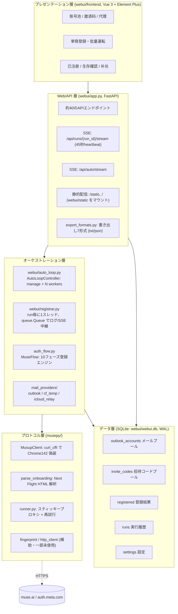

# アーキテクチャ

## 全体構成

3 層 + データ層です。スケジューラは `asyncio` ではなく**素の `threading`** で、FastAPI は主に「外側の殻」として API と SSE を提供します。

## スレッドモデル

| 役割 | 実装 | 場所 |
| --- | --- | --- |
| HTTP サーバ | `uvicorn`（`start_webui.py:60-66`） | `start_webui.py` |
| 自動運転の監督 | `threading.Thread(name="auto-loop-manage")` | `auto_loop.py:101-104` |
| 自動運転のワーカー | `threading.Thread(name="auto-loop-worker-N")` × concurrency | `auto_loop.py:290-317` |
| 1 登録 = 1 スレッド | `threading.Thread(name=f"register-{run_id}")` | `registrar.py:257-263` |
| プロキシ一括テスト | `ThreadPoolExecutor` | `app.py:313` 付近 |

- ワーカーは起動時に 0.6 秒ずつずらして起動されます（`auto_loop.py:300-308`）。
- ワーカーは `_stop_event` / `_pause_event` を 0.15〜0.4 秒間隔でポーリングします。停止・一時停止は協調的で、実行中の登録は完走します。
- 一時停止時は未消費のメールとプロキシのロックを返却します（`auto_loop.py:332-337`）。
- ログは `QueueLogHandler` がスレッドローカルの `run_id` でフィルタし、ファイルと `queue.Queue` の両方へ書きます（`registrar.py:35-66`）。`_run_queues` はプロセス内辞書です（`registrar.py:27`）。

## SSE によるライブ表示

- 単発/実行単位: `GET /api/runs/{run_id}/stream`（`app.py:398-433`）。45 秒ごとに heartbeat を送ります。キューは `finally` でしか解放されないため、**一度も stream を開かなかった run のキューはプロセス再起動まで残ります**（`app.py:421-422`）。
- 自動運転: `GET /api/auto/stream`（`app.py:725-756`）。`state` / `run_started` / `run_finished` / `circuit_break` のイベントを配信します。

## スティッキープロキシ割り当て

`AutoLoopController._pick_proxy`（`auto_loop.py:170-205`）:

1. プロキシプールが空 → 単一の `proxy` オプションを返す（無ければ空文字 = **直結**）。
2. 現在使用中の行が bad でなく avoid でもない → そのまま再利用（sticky）。
3. 未使用行からランダムに 1 つ確保して `_proxy_claims` に記録。
4. 全て使用中なら bad でない行を共有（プール数 < 同時実行数）。

`max_per_ip` 回成功したらその行を解放し、`_pool_bad` に積んで別 IP へ切替えます（`auto_loop.py:463-470`）。`resume` 時は `_pool_bad.clear()` でクリアし、プロキシ修正後に再開できるようにします（`auto_loop.py:126-132`）。

## データベース

`webui/db.py`。`webui/webui.db`（WAL モード）、スレッドローカル接続です（`db.py:26` の `_tls` と `db.py:31` の `_conn`）。

| テーブル | 主な列 | 用途 |
| --- | --- | --- |
| `settings` | `key`, `value` | `mail_source` と `cf_*` のみ |
| `outlook_accounts` | `email`(PK), `password`, `client_id`, `refresh_token`, `relay_url`, `kind`, `status`, `imported_at`, `claimed_at`, `finished_at`, `fail_reason` | メールプール。`kind` で方式を区別 |
| `registered` | `email`, `password`, ほか認証成果物（`session_token`, `access_token`, `account_id`, `own_code`, `used_invite_code`）, `status`, `stage`, … | 登録結果 |
| `runs` | `run_id`, `email`, `status`, `error`, `error_category`, `stage`, `log_path` | 実行履歴・失敗カテゴリ |
| `invite_codes` | `code`(PK), `status`, `used_count`, `max_uses`(既定 30), `source`, `note` | 招待コードプール |

ステータス値:

- メール: `available` / `in_use` / `done` / `failed`
- 招待コード: `available` / `exhausted` / `invalid`
- run: `running` / `done` / `failed`
- 登録結果: `registered_unactivated` / `registered_waitlist` / `registered_pending_redemption` / `redeemed` / `activated`

排他制御は `UPDATE ... WHERE status='available'` + `rowcount == 1` の guarding 方式です（`db.py:269` `claim_account`、`db.py:293` `claim_next`）。`in_use` の残留は起動時と API から解放できます（`db.py:392` `release_stale_in_use`、既定 1800 秒。`app.py:37-42` が import 時に実行）。

> `_invite_inflight`（`db.py:21`）は**プロセス内メモリ**です。招待コードの同時実行枠を数えるだけで、再起動すると消えます。

## API エンドポイント（代表）

| メソッド・パス | 役割 |
| --- | --- |
| `GET /api/health`, `GET /api/stats` | 死活・集計（`app.py:165`, `:175`） |
| `POST /api/import` | メール行の投入（`app.py:188`） |
| `POST /api/import/icloud_local` | `../icloud` からローカル生成して投入（`app.py:202`） |
| `GET/DELETE/POST /api/accounts*` | メールプールの参照・削除・一括削除・reset・release_stale（`app.py:215-273`） |
| `GET /api/invites`, `/stats`, `POST /import`, `/reset` | 招待コード管理（`app.py:275-311`） |
| `POST /api/proxy/test` | プロキシ一括テスト（`app.py:313`） |
| `POST /api/register` | 単発登録（`app.py:357`） |
| `GET /api/runs/{run_id}/stream`, `GET /api/runs` | 実行ログ SSE・履歴（`app.py:398`, `:442`） |
| `GET /api/registered`, `/export`, `/export/formats` | 登録済み一覧・エクスポート（`app.py:450-495`） |
| `POST /api/registered/check_live` | 生存確認 + `own_code` 回収（`app.py:497`） |
| `POST /api/registered/redeem` | 招待コード未交換分のまとめ交換（`app.py:537`） |
| `GET /api/mail/providers`, `GET/POST /api/settings/mail`, `POST /api/settings/mail/test` | メール方式の設定（`app.py:637-686`） |
| `POST /api/auto/start|pause|resume|stop`, `GET /api/auto/status`, `/stream` | 自動運転の制御（`app.py:688-760`） |
| `GET /` , `/static/*` | フロント配信（`app.py:762-767`） |

## 環境変数と設定キー

| 名前 | 場所 | 意味 |
| --- | --- | --- |
| `PYTHONIOENCODING` | `start_webui.py:19-21` | コンソール出力の文字化け対策 |
| `NO_PROXY` / `no_proxy` | 同上 | 直結させたいホストの除外 |
| `ICLOUD_DB_PATH` | `import_icloud.py:20` | `../icloud` の DB パス上書き |
| `VITE_API_BASE` | フロントのビルド時のみ | API のベース URL |

DB `settings` テーブルに保存されるキーは `mail_source` と `cf_api_url` / `cf_admin_token` / `cf_domain` だけです。

## 起動とフロント

- `start_webui.py:43-49` が `fastapi` / `uvicorn` の不在を検知して自動 `pip install` します。
- `start_webui.py:60-66` が既定 **8766** で `uvicorn.run("webui.app:app")` します。
- フロントは `vite.config.js:14,20-22` で `base: '/static/'`、`outDir: '../static'`、`emptyOutDir: true`。ビルド成果物は `webui/static/` として**コミット済み**なので、通常運用で npm は不要です。
