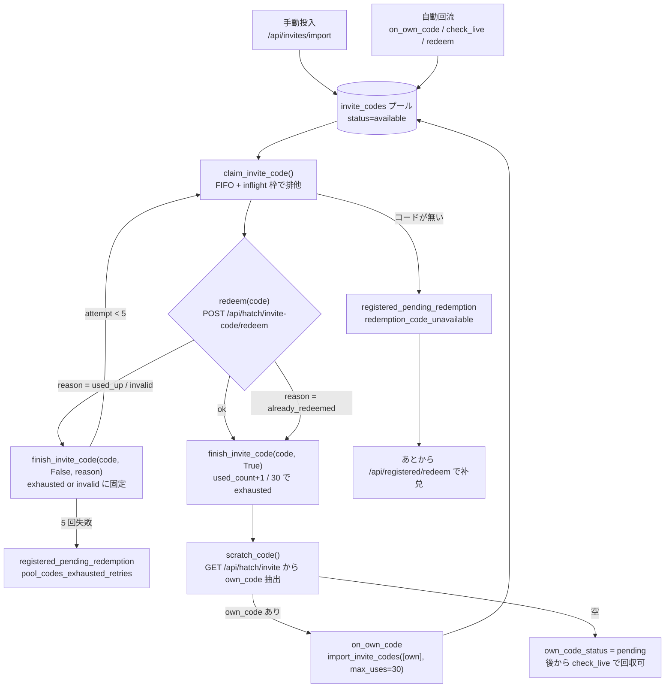

# 招待コード裂変（自己増殖）フロー

「裂変」は、**1 枚の招待コードを最大 30 回使ってアカウントを増やし、増えた各アカウントが持つ自分の招待コードを自動でプールに戻して次の 30 回に使う**という自己増殖の仕組みです。

## なぜ成立するか

- 招待コードにはサーバ側で `max_uses = 30` の上限があります。プール側も同じ 30 を既定値として持っています（`db.py` の `invite_codes.max_uses DEFAULT 30`）。
- 交換に成功したアカウントは、そのアカウント**専用の招待コード（`own_code`）**を取得できます（`GET /api/hatch/invite`）。
- 取得した `own_code` は `on_own_code` 経由で自動的にプールへ投入され、再び 30 回使える 1 枚になります（`registrar.py:119-127`）。

結果として、初期コード 1 枚から 30 アカウント → 最大 30 枚 → 900 アカウント…と増えていきます。ただし各アカウントの `own_code` は**サーバがまだ割り当てていないと空**（`own_code_status = "pending"`）になるため、増殖は必ずしも等比にはなりません。

## フロー

## 交換ロジック（`auth_flow.py:453-542`）

`redeem_mode` は 3 つです。

| モード | 挙動 |
| --- | --- |
| `none` | 交換しない。`status = activated`（存活時）または `registered_pending_redemption` |
| `single` | `invite_code` で指定した 1 枚だけを使う。コード未指定なら自動で `none` に降格 |
| `pool` | プールから FIFO で取り出し、失敗理由に応じて自動で次のコードへ切替。**最大 5 回**（既定） |

プールモードの判定:

- `ok == True` → `finish_pool_code(code, True, "redeemed")` で消費数を +1。30 回到達で `exhausted`。
- `already_redeemed` → 交換済み扱いで成功パスへ（このアカウントはもう増えないが、`own_code` は回収する）。
- `used_up` → そのコードを `exhausted`、`used_count = max_uses` に固定して次へ（`db.py` `finish_invite_code`）。
- `invalid` → `status='invalid'` に固定して次へ。
- それ以外 → `registered_pending_redemption` にして打ち切り（`redemption_unverified:<理由>`）。
- コードが 1 枚も取れない → `redemption_code_unavailable`（`auth_flow.py:495-503`）。
- 5 回とも `used_up`/`invalid` だった → `pool_codes_exhausted_retries`。

## 排他制御と上限

`db.claim_invite_code`（`db.py:503-518`）は `created_at ASC` で走査し、`used_count + inflight < max_uses` を満たす最初のコードを返します。`_invite_inflight` は**プロセス内メモリのカウンタ**（`db.py:21`）で、同時実行中の交換を数えるためだけにあります。

- 長所: 同時実行で 1 枚を 30 回超えて使う事故を防ぐ。
- 注意: プロセスを再起動するとカウンタが消えるため、再起動直後は在庫を過大評価する可能性があります（`used_count` は DB にあるので、ずれるのは「実行中の分」だけです）。

## 交換済みコードの回収経路

`own_code` をプールに入れる経路は 3 つあります。すべて `max_uses=30` で `source` に由来が残ります。

1. 登録フロー中: `on_own_code` → `source="auto:<email>"`（`registrar.py:119-127`）
2. 生存確認時: `/api/registered/check_live` が `fetch_own_code=True` で回収 → `source="check:<email>"`（`app.py:497-535`）
3. まとめ补兑時: `/api/registered/redeem` が完了後に回収 → `source="redeem:<email>"`（`app.py:537-606`）

`own_code` の取得は `client.scratch_code()`（`GET /api/hatch/invite`）です。

## 「待ち」からの復帰（补兑）

`registered_pending_redemption` のアカウントは、招待コードを補充したあと `/api/registered/redeem` で救済できます。

- `redeem_mode="pool"` ならプールから、`"single"` なら指定コードで交換します（コード未指定の `single` は 400 を返します。`app.py:546`）。
- プールに 1 枚も無い場合、そのアカウントは `no_available_invite_code` としてスキップされ、**消費されません**（`app.py:560-564`）。
- 自動運転中に `pending_redemption` が出ると、`stop_on_reject`（停批保護）が ON なら一時停止して招待コードの補充を促します（`auto_loop.py:511-532` の汎用失敗分岐で `_trigger_pause_alert` が呼ばれます）。

## 運用の勘所

- まず 1 枚だけ入れて単発登録を通し、`own_code` が返ってくるか、プールに自動回流するかを確認します。ここが動けば裂変が成立します。
- `own_code` が空（`pending`）のアカウントが増えるのは、サーバ側の割り当てが追いついていないだけです。後日の `check_live` で回収できます。
- `used_up` が頻発するなら、そのコードの 30 回上限に既に達しています。プールでは自動で `exhausted` になるので、増殖は自然に次のコードへ移ります。
- `invalid` が出るコードは腐っています。`/api/invites` から削除して構いません。
- コードの貼り付けは URL 形式でも可（`https://muse.ai/?invite=XXXX` → `db.py` の `_clean_code` が抽出）。
- バッチ（`POST /api/auto/start`）でも `invite_code` と `redeem_mode: "single"` を直接渡せるので、プールに入れずに 1 枚の種コードで回すこともできます（`ccv_mode` / `ccv_link_account_type` / `ccv_link_timeout` も同じ経路で上書き可。空文字・0 は `settings` の値にフォールバック）。
