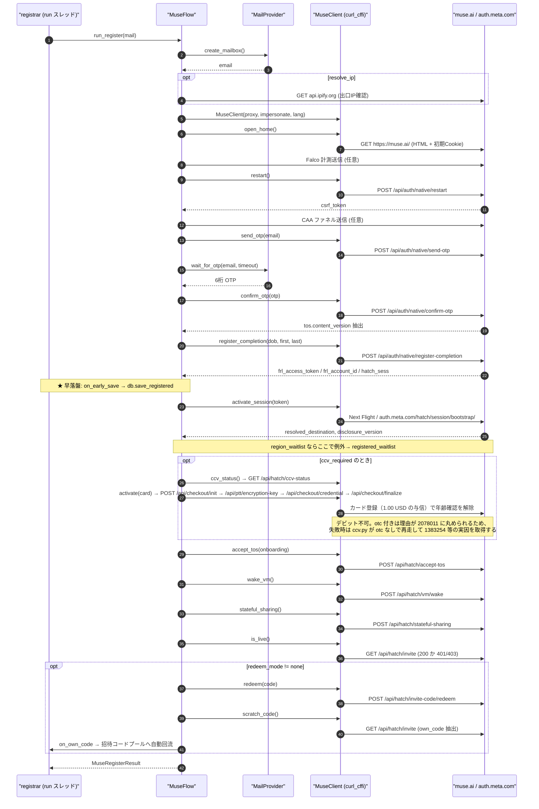

# 登録処理フロー（10 フェーズ）

`auth_flow.py` の `MuseFlow.run_register`（`auth_flow.py:195-451`）が実行するプロトコル手順です。すべて HTTP で、`musepy/client.py` の `MuseClient` が Chrome 142 のヘッダ群（`musepy/client.py:33-51`）を付けて `curl_cffi` で送ります。

## 全体シーケンス

## フェーズ一覧

`_phase()` のログ表記は `[n/10]` です。`stage` 名はそのまま `runs.stage` に記録され、再試行や停止判断に使われます。

| # | stage 名 | 内容 | 主なエンドポイント | 成果物 | 失敗カテゴリ |
| --- | --- | --- | --- | --- | --- |
| 0 | `initialized` | メールボックス確保 | — (Provider 依存) | `email` | `pre_send_network` / `account` |
| 1 | `ip_check` | 出口 IP 確認（`resolve_ip` 時のみ） | `GET https://api.ipify.org` | `result.ip` | `pre_send_network` |
| 2 | `bootstrap` | トップページ取得で初期 Cookie、Falco 計測 | `GET https://muse.ai/` | Cookie, `waterfall_id` | `pre_send_network` |
| 3 | `restart` | 登録セッション初期化 | `POST /api/auth/native/restart` | `csrf_token` | `pre_send_network` / `server_rejected` |
| 4 | `send_otp` | 6 桁コードをメール送信 | `POST /api/auth/native/send-otp` | 送信時刻 | `server_rejected` |
| 5 | `wait_otp` | メール受信箱をポーリング | — (Provider 依存) | `otp_code` | `otp_timeout` |
| 6 | `confirm_otp` | コード検証。**TOS バージョンを動的抽出** | `POST /api/auth/native/confirm-otp` | `tos_content_version` | `server_rejected` |
| 7 | `completion` | 姓名・生年月日を送信しアカウント作成 | `POST /api/auth/native/register-completion` | `frl_access_token`, `frl_account_id`, `hatch_sess` → **早落盤** | `server_rejected` |
| 8 | `session_bootstrap` | Next Flight 会话引导、動的披露文と遷移先を解析。**地区判定の関門** | `auth.meta.com/hatch/session/bootstrap/` | `resolved_destination`, `disclosure_version` | `region_waitlist` ほか |
| 8.5 | `ccv` | 年齢確認の解除（`ccv_required` のときだけ）。**クレジットカード必須（デビット不可）** | `GET /api/hatch/ccv-status`, `POST /api/checkout/init` → `/api/ptt/encryption-key` → `/api/checkout/credential` → `/api/checkout/finalize` | `ccv_status` / `ccv_error` | 失敗しても続行（ただし以降の hatch API は 403 のまま）。`2078011` のときは otc なしで再走して `1383254` / `2078022` を出す |
| 9 | `accept_tos` | 規約同意 | `POST /api/hatch/accept-tos` | 更新後 `hatch_sess` | `server_rejected` |
| 9.5 | `wake` | クラウド VM 起こし（`wake_trigger=mount`） | `POST /api/hatch/vm/wake` | `vm_id`（HTML から抽出、失敗しても続行） | `protocol_error` |
| 9.6 | `sharing` | stateful-sharing | `POST /api/hatch/stateful-sharing` | — | `protocol_error` |
| 9.7 | `invite` | 存活確認（`is_live`） | `GET /api/hatch/invite` が 200 か 401/403 | `is_live` | `protocol_error` |
| 10 | `redeem` / `own_code` | 招待コード交換 → 本アカウントの `own_code` 抽出 | `POST /api/hatch/invite-code/redeem`, `GET /api/hatch/invite` | `used_invite_code`, `own_code` | `redemption_unverified:` + 理由 |

## 早落盤（early save）

`register-completion` が成功して `frl_access_token` が取れた**直後**、`on_early_save` が呼ばれて DB に保存されます（`auth_flow.py:340-346` → `registrar.py:115-117` → `db.save_registered`）。

これ以降のフェーズ（`session_bootstrap` 以降）で失敗しても、**アカウント自体は失われません**。`registered_unactivated` / `registered_waitlist` として残り、あとから `check_live` や `redeem` で救済できます。

## 地区制限（waitlist）の判定

`session_bootstrap` 〜 `accept_tos` の間にサーバが `region_waitlist` を返すと、`auth_flow.py:408-415` が `status = "registered_waitlist"` にして `category="region_waitlist"` の例外を投げます。アカウントは作成済みなので保持されます。

- ワーカーはこれを検知して `_registered_waitlist` をカウントし、`stop_on_reject` が ON なら**自動一時停止**して「IP を替えて『恢复』」と促します（`auto_loop.py:494-509`）。
- 発端は `musepy/client.py:296-303` の言語判定で、`lang` が `ja` 始まりのとき `region="JP"` が固定送信される点です。

## 失敗カテゴリ（`runs.error_category`）

| カテゴリ | 意味 | 自動処理 |
| --- | --- | --- |
| `pre_send_network` | OTP 発送前のネットワーク異常（`initialized` / `bootstrap` / `restart` / `ip_check`） | 副作用ゼロ。メールをプールへ返却し、**プロキシプールが 2 本以上あれば**別プロキシで最大 3 回再試行（`auto_loop.py:472-492`）。プールが空（直結）のときは再試行せず失敗になります |
| `otp_timeout` | 6 桁コードが `otp_timeout` 秒以内に届かない | 失敗扱い。メールは消費 |
| `server_rejected` | `restart` / `send-otp` / `confirm-otp` / `register-completion` / `accept-tos` がサーバ拒否 | 失敗として記録 |
| `region_waitlist` | 地区制限 | 保持 + 自動一時停止（`stop_on_reject` ON 時） |
| `post_send_network` | OTP 発送後のネットワーク異常 | 失敗として記録（早落盤済みなら保持） |
| `protocol_error` | 想定外レスポンス（HTML 解析失敗等） | 失敗として記録 |
| `account` | メール Provider の致命的エラー（認証失効等） | そのメール行を `failed` に |
| `timeout` | `_wait_run_finish` が 900 秒でタイムアウト | 失敗として記録 |
| `unknown` | 未分類例外 | 失敗として記録 |
| `pending_redemption` | 登録・激活はできたが招待コード交換が未完 | `stop_on_reject` ON なら自動一時停止（招待コード補充を促す） |

## 事前判定と副作用

`FLOW_PRE_SEND_STAGES = PRE_SEND_STAGES | {"ip_check"}`（`auth_flow.py:28`。`PRE_SEND_STAGES` は `initialized` / `bootstrap` / `restart`、`musepy/runner.py:14`）。この集合に含まれる段階のネットワーク失敗だけが**無副作用リトライ**の対象です。`send_otp` 以降はメールが既に使われているため、メールを戻さず別の行を使います。

## 生成される個人情報

- 姓名は日本語の名前プールからランダム（`musepy/runner.py` の `SURNAMES` / `GIVEN_NAMES`）。`register_completion` の引数順は **`first_name`=名、`last_name`=姓**。
- 生年月日は `random_dob()` で 18 歳以上を生成。
- リクエスト言語は既定 `ja`（`registrar.py:139` が `options.get("lang") or "ja"`）。
